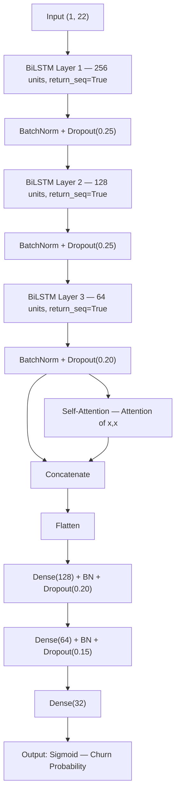

# EarlySence — Customer Churn Prediction System

> A production-grade ML system for telecom customer churn prediction using a Bidirectional LSTM with Self-Attention, Behavioral Drift Analysis (PSI), and Explainable AI (SHAP) — served through an interactive Streamlit dashboard.

---

## Problem Statement

Telecom companies face significant revenue loss from customer churn. Reacting after a customer leaves is expensive. This system aims to **predict churn before it happens**, explain *why* a customer is at risk, and detect *when* behavioral patterns are shifting — enabling proactive retention strategies.

---

## Key Features

- **Bidirectional LSTM + Self-Attention** for binary churn classification
- **6 Engineered Interaction Features** capturing behavioral signals (engagement score, loyalty index, risk score, etc.)
- **SMOTE** oversampling to handle class imbalance
- **Behavioral Drift Analysis** using Population Stability Index (PSI) across 5 simulated temporal windows
- **SHAP (KernelExplainer)** for both global feature importance and per-prediction explanations
- **Streamlit Dashboard** with 8 pages: Dashboard, New Prediction, Customer Search, LSTM Performance, Behavioral Drift, Explainable AI, Churn Report, Model Overview
- **Retention Action Engine**: AI-generated retention recommendations based on churn probability tier

---

## How the System Works

### End-to-End Pipeline

```
Raw Dataset (churn_noisy.xlsx)
        |
        v
analyze_noisy.py          <- Column naming, EDA, noise detection
        |
        v
train.py
  +-- Preprocessing        <- Label encoding, feature engineering, StandardScaler
  +-- SMOTE               <- Synthetic minority oversampling (class balance)
  +-- BiLSTM Model        <- 3x BiLSTM + Self-Attention + Dense layers
  +-- Behavioral Drift    <- PSI computed across 5 temporal windows
  +-- SHAP Explainability <- KernelExplainer on 50 samples, kmeans(10) background
        |
        v
Saved Artifacts
  +-- lstm_churn_model.h5
  +-- scaler.pkl, feature_names.pkl
  +-- le_age.pkl, le_plan.pkl, le_status.pkl
  +-- shap_background.csv, shap_results.pkl
  +-- training_results.json  (metrics + drift + SHAP importance)
        |
        v
app.py (Streamlit)        <- Interactive dashboard for analysis & live prediction
```

### Prediction Flow (Live)
1. User inputs 16 customer attributes via the dashboard
2. 6 interaction features are computed on-the-fly
3. Input is scaled using the saved `StandardScaler`
4. Reshaped to `(1, 1, 22)` tensor for LSTM inference
5. Model outputs a churn probability (0–1)
6. Risk tier (Low / Moderate / High / Critical) and retention action are displayed
7. SHAP values are computed in real-time for per-customer explanation

---

## Tech Stack

| Layer | Technology |
|---|---|
| ML Framework | TensorFlow / Keras |
| Classical ML | scikit-learn (preprocessing, metrics, SMOTE via imbalanced-learn) |
| Explainability | SHAP (KernelExplainer + kmeans background) |
| Data Processing | Pandas, NumPy |
| Dashboard | Streamlit |
| Visualization | Matplotlib |
| Model Persistence | Keras `.h5`, joblib `.pkl` |
| Dataset | Custom synthetic telecom dataset (`churn_noisy.xlsx`, ~2,850 records) |

---

## Architecture



---

## Project Structure

```
EarlySence/
+-- README.md
+-- Customer_churn/
    +-- analyze_noisy.py          # EDA, column naming, noise detection
    +-- train.py                  # Full ML pipeline (preprocessing to SHAP)
    +-- app.py                    # Streamlit dashboard (8 pages)
    |
    +-- churn_noisy.xlsx          # Raw dataset (no headers)
    +-- churn_noisy_named.xlsx    # Cleaned dataset with column names
    +-- WA_Fn-UseC_-Telco-...csv  # Reference Telco dataset
    |
    +-- lstm_churn_model.h5       # Trained Keras model (~17MB)
    +-- scaler.pkl                # Fitted StandardScaler
    +-- feature_names.pkl         # Ordered feature list (22 features)
    +-- le_age.pkl                # LabelEncoder for AgeGroup
    +-- le_plan.pkl               # LabelEncoder for PlanType
    +-- le_status.pkl             # LabelEncoder for Status
    |
    +-- shap_background.csv       # 100-sample background for KernelExplainer
    +-- shap_results.pkl          # SHAP values + explanation samples
    +-- training_results.json     # All metrics, drift data, SHAP importance
```

---

## Installation & Setup

**Prerequisites:** Python 3.8–3.10, pip

```bash
# Clone the repository
git clone https://github.com/<your-username>/EarlySence.git
cd EarlySence/Customer_churn

# Create a virtual environment (recommended)
python -m venv venv
venv\Scripts\activate        # Windows
# source venv/bin/activate   # Linux/Mac

# Install dependencies
pip install tensorflow scikit-learn imbalanced-learn shap streamlit \
            pandas numpy matplotlib openpyxl joblib
```

---

## How to Run

### Step 1 — Prepare the Dataset
```bash
python analyze_noisy.py
# Outputs: churn_noisy_named.xlsx
```

### Step 2 — Train the Model
```bash
python train.py
# Outputs: lstm_churn_model.h5, scaler.pkl, training_results.json, shap_results.pkl, etc.
```

### Step 3 — Launch the Dashboard
```bash
streamlit run app.py
# Opens at http://localhost:8501
```

> If model artifacts already exist (pre-trained), you can skip Steps 1–2 and go directly to Step 3.

---

## Dataset Details

| Property | Value |
|---|---|
| Source | Custom synthetic telecom dataset (`churn_noisy.xlsx`) |
| Records | ~2,850 customers |
| Original Features | 13 numerical + 3 categorical |
| Target | `Churn` (binary: 0 = retained, 1 = churned) |
| Class Imbalance | Addressed via SMOTE (auto strategy) |
| Noise | Intentional noise in `MonthlySpend`, `PlanDuration`, `OverageFee`, `RoamingCalls` |

### Features Used for Training (22 total)

| # | Feature | Type | Description |
|---|---|---|---|
| 1–13 | AccountAge, DataUsage, Age, MonthlySpend, CallDuration, CallFrequency, SMSFrequency, DataFrequency, PlanDuration, OverageFee, RoamingCalls, CustomerSatisfaction, ComplaintRate | Original | Raw numerical signals |
| 14–16 | AgeGroup_enc, PlanType_enc, Status_enc | Encoded | Label-encoded categoricals |
| 17 | Usage_Intensity | Engineered | DataUsage × CallFrequency |
| 18 | Spend_Satisfaction | Engineered | MonthlySpend × CustomerSatisfaction |
| 19 | Complaint_Usage_Ratio | Engineered | ComplaintRate / (DataUsage + ε) |
| 20 | Engagement_Score | Engineered | Mean of CallDuration, SMSFrequency, DataFrequency |
| 21 | Loyalty_Index | Engineered | AccountAge × CustomerSatisfaction |
| 22 | Risk_Score | Engineered | ComplaintRate × RoamingCalls / (Satisfaction + ε) |

---

## Model Performance (Actual Results)

| Metric | Value |
|---|---|
| **Accuracy** | **89.34%** |
| **Precision** | **85.80%** |
| **Recall** | **94.29%** |
| **F1-Score** | **89.84%** |
| **ROC-AUC** | **95.99%** |

**Confusion Matrix** (910 test samples, post-SMOTE balanced split):

|  | Predicted: No Churn | Predicted: Churn |
|---|---|---|
| **Actual: No Churn** | 384 (TN) | 71 (FP) |
| **Actual: Churn** | 26 (FN) | 429 (TP) |

> High recall (94.29%) was prioritized by design — in churn prediction, missing a churner (FN) is far more costly than a false alarm (FP).

---

## Key Technical Implementation Decisions

### 1. Why LSTM for Tabular Churn Data?
Standard tabular churn problems use tree-based models (XGBoost, etc.). Using BiLSTM here was a deliberate architectural exploration: each customer's feature vector is treated as a single timestep `(1, 22)`, and the bidirectional architecture learns richer internal representations. The self-attention layer identifies which feature interactions matter most.

### 2. Self-Attention Concatenation
Rather than replacing the LSTM output with attention, both the LSTM output and attention output are **concatenated** before flattening. This preserves the raw LSTM representation while augmenting it with attention-weighted context.

### 3. SMOTE Before Split
SMOTE is applied before the train/test split on the full dataset, resulting in an 80/20 stratified split post-SMOTE. This ensures balanced class distribution in both training and test sets.

### 4. Behavioral Drift via PSI
The dataset is split into 5 equal temporal windows. PSI is computed between Window 1 and Window 5 for each numerical feature. PSI > 0.2 = High drift; 0.1–0.2 = Medium; < 0.1 = Low. This simulates model monitoring conditions in production.

### 5. SHAP with KernelExplainer
Since SHAP's `DeepExplainer` requires a specific TF session setup, `KernelExplainer` is used — model-agnostic and fully compatible with any black-box. A k-means summary of 100 background samples (compressed to 10 centroids) approximates the feature expectation efficiently.

### 6. Streamlit Caching Strategy
- `@st.cache_resource` for the Keras model (singleton, not re-serialized per session)
- `@st.cache_data` for data artifacts (scaler, feature names, dataset, results JSON)

---

## Challenges & Engineering Decisions

| Challenge | Solution |
|---|---|
| Dataset had no column headers | Built `analyze_noisy.py` to infer column semantics from data type/range analysis |
| Noisy/out-of-range values | Detected via range checks; handled with `replace(inf, nan)` and `fillna(0)` |
| Class imbalance | SMOTE oversampling with `sampling_strategy='auto'` |
| SHAP incompatibility with BiLSTM 3D tensors | Wrapped model inference in a flat `(N, 22)` → reshape `(N, 1, 22)` adapter function |
| LSTM overfitting | `EarlyStopping(patience=20)` + `ReduceLROnPlateau(factor=0.5)` + Dropout + BatchNorm at every layer |
| Dashboard loading performance | Keras model and all artifacts loaded once using Streamlit's caching decorators |

---

## Future Improvements

- [ ] **Real temporal sequences**: Use actual timestamped transaction data for genuine multi-timestep LSTM input
- [ ] **Automated retraining**: Trigger retraining when PSI exceeds threshold (true MLOps loop)
- [ ] **Threshold tuning UI**: Interactive classification threshold adjustment on the ROC curve
- [ ] **Batch prediction upload**: CSV upload for bulk churn scoring
- [ ] **SHAP beeswarm plots**: Richer global explanations beyond mean |SHAP| bar charts
- [ ] **Model versioning**: Track experiments with MLflow or Weights & Biases
- [ ] **FastAPI layer**: REST endpoint for CRM/system integration

---

## Interview Talking Points

**"What did you build?"**
> A full ML pipeline for telecom churn prediction — from raw noisy data through feature engineering, BiLSTM training, SHAP explainability, and behavioral drift monitoring — served as an interactive dashboard.

**"Why BiLSTM instead of XGBoost/Random Forest?"**
> It was an intentional architectural experiment to explore whether a deep learning approach could match tree-based baselines on small tabular data. The self-attention mechanism lets the model learn cross-feature dependencies that standard dense networks might miss.

**"How did you handle model explainability?"**
> SHAP's KernelExplainer was used — model-agnostic and fully compatible with the Keras BiLSTM. A custom adapter wraps the 3D LSTM inference to present a flat interface to SHAP, yielding both global importance rankings and per-customer feature contribution charts.

**"What is Behavioral Drift Analysis?"**
> A technique borrowed from production ML monitoring. The static dataset is split into 5 temporal windows, and PSI is computed between the first and last to detect feature distribution shifts — a proxy for detecting when a deployed model would become stale.

**"How did you handle class imbalance?"**
> SMOTE was applied before the train-test split, generating synthetic churned-customer samples for a balanced 50/50 distribution. This is why recall (94.29%) is high — the model doesn't underpredict the minority class.

**"What does the ROC-AUC of 95.99% mean?"**
> The model has a very high ability to discriminate between churners and non-churners across all classification thresholds. This is more meaningful than accuracy alone and directly informs decisions like how aggressive to make the retention threshold.
